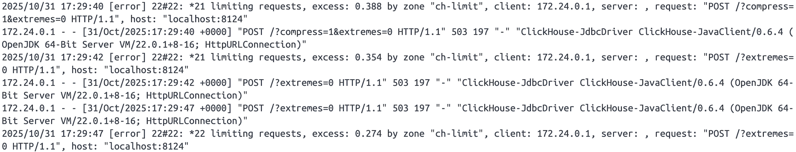
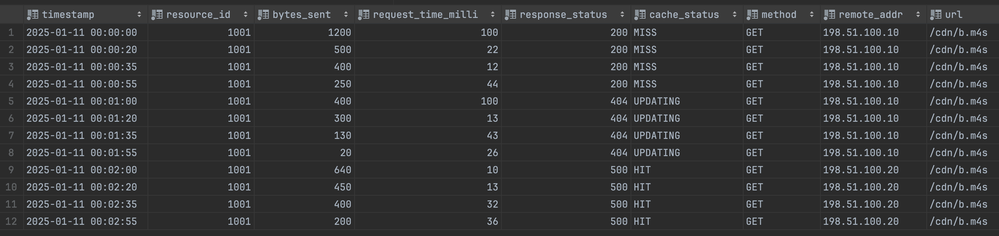
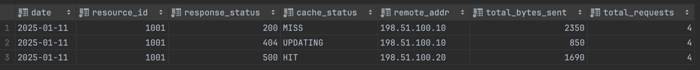

# README.md

## Contents
- [Introduction](#introduction)  
- [Cap'n Proto decoding](#capn-proto-decoding)  
- [ClickHouse](#clickhouse)  
  - [Connecting Java to ClickHouse](#connecting-java-to-clickhouse)  
  - [Proxy request limiting](#proxy-request-limiting)  
  - [Storing data in the database](#storing-data-in-the-database)  
  - [Aggregation table](#aggregation-table)  
    - [Does this table meet expectations?](#does-this-table-meet-expectations)  
    - [Estimating the required disk space](#estimating-the-required-disk-space)  
    - [Retention period of aggregated data](#retention-period-of-aggregated-data)  
- [Reliable message processing](#reliable-message-processing)  
  - [Manual offset commits](#manual-offset-commits)  
  - [Graceful shutdown](#graceful-shutdown)  
- [What could be done better](#what-could-be-done-better)  
  - [Database unavailability](#database-unavailability)  
  - [Duplicate records](#duplicate-records)  
- [Conclusion](#conclusion)  

## Introduction
Assignment: [Anonymizer](task.md)
In the following sections, I will go through the individual parts of the whole solution one by one and describe their implementation, as well as the problems I ran into.

## Cap'n Proto decoding
Since the compiler for Cap'n Proto is written in C++, I had to find a suitable alternative for Java. Fortunately, there is a library called [capnproto-java](https://github.com/capnproto/capnproto-java/), which I used to generate the `HttpLog` class from the [http_log.capnp](capnp/http_log.capnp) schema. I then used this class to decode the messages received from Kafka.

## ClickHouse
After decoding and transforming the data according to the assignment (changing the last octet to `X`), the biggest challenge of the whole task followed — storing the data in the ClickHouse database. Several specific problems had to be solved: connecting Java to the ClickHouse database, dealing with the rate limit of 1 request per minute, and creating a new table so that it would allow fast and efficient querying.

### Connecting Java to ClickHouse
My first thought was to use the standard **JPA (Java Persistence API)**. However, after a bit of research it turned out to be a suboptimal solution. The reason was that JPA is primarily designed for **OLTP (Online Transaction Processing)** databases, that is, row-oriented relational databases where you mostly work with a relatively small amount of data that is frequently updated.

Nevertheless, ClickHouse is an **OLAP (Online Analytical Processing)** database, which is optimized for working with large amounts of data and storing it in bulk. Therefore, I used the `clickhouse-jdbc` JDBC driver, which is also recommended by the ClickHouse [documentation](https://clickhouse.com/docs/integrations/language-clients/java/jdbc) itself.

### Proxy request limiting
Next came the part that personally gave me by far the most trouble. According to the assignment, the application had to communicate with ClickHouse only through an **nginx proxy**, which had a limit of **1 request per minute** set.

The first problem appeared when I tried to insert just a single record into the database. No insertion happened, and the reason was that, together with the INSERT query, several other queries were generated — specifically `POST /?extremes=0` and `POST /?compress=1&extremes=0`. These queries were sent before the INSERT itself, and therefore no data was stored.

I assumed that these queries were sent automatically with every request and that they were, for example, loading the table itself before storing data into it. However, it turned out that this was a false assumption, because even after increasing the request limit no change occurred. Moreover, after checking the logs in Docker, it became clear that these requests were being sent at regular intervals.



I found out that these were **health check** requests, which would also explain why they were being sent at regular intervals. It occurred to me to reconfigure the proxy so that the rate limit would apply to all requests except these health check ones. However, such a solution is inherently inappropriate, and for a while I found myself at a dead end.

After several hours of trial and error, I eventually discovered that the root of the problem was somewhere completely different than I had expected. I was in fact using an outdated version of the `clickhouse-jdbc` driver, and simply switching to a newer version solved everything, since in the newer version the application no longer sent the health check requests.

### Storing data in the database
Now that I was able to store data in the database, I had to choose a suitable way to store this data in batches rather than one by one, in order to deal with the configured proxy limit.

Each record is therefore stored, after decoding, into a queue of type `ConcurrentLinkedQueue`, which ensures safe access from multiple threads. At regular intervals of `65 seconds`, the application then tries to store all the data from the queue into the database, where the five-second difference compared to the limit serves as a small reserve.

In case the write fails, the data is simply returned back into the queue and an attempt to store it is made on the next try. How I made sure the data is not lost even if the application crashes or is shut down is described in the [Reliable message processing](#reliable-message-processing) section.

### Aggregation table
Storing the data in the database is not the end of the process, and it was necessary to ensure fast and efficient querying of this data, ideally within a few seconds.

For this purpose, I created the `http_log_total_traffic` table, which uses the `SummingMergeTree` engine. This engine is special compared to the standard MergeTree in that it automatically sums numeric columns (in our case `total_bytes_sent` and `total_requests`) when merging records, thanks to which we achieve a much faster response when reading the data.

Furthermore, I divided the table into partitions, which allows the data to be stored in blocks according to a certain key (in our case the date). If a query contains a filter on some time period, ClickHouse does not have to go through the whole table row by row, but only the selected block corresponding to that date.

```
CREATE TABLE IF NOT EXISTS http_log_total_traffic
(
  date                Date,
  resource_id         UInt64,
  response_status     UInt16,
  cache_status        LowCardinality(String),
  remote_addr         String,
  total_bytes_sent    UInt64,
  total_requests      UInt64
)
ENGINE = SummingMergeTree((total_bytes_sent, total_requests))
PARTITION BY toYYYYMM(date)
ORDER BY (date, resource_id, response_status, cache_status, remote_addr);
```

In order for data to be stored into this newly created table automatically, it was necessary to create a `MATERIALIZED VIEW`. After every record is inserted into the standard `http_log` table, it recalculates the data and writes it into the `http_log_total_traffic` table.

```
CREATE MATERIALIZED VIEW http_log_materialized_view  
TO http_log_total_traffic  
AS  
SELECT  
  toDate(timestamp) AS date,  
  resource_id,  
  response_status,  
  cache_status,  
  remote_addr,  
  sum(bytes_sent) AS total_bytes_sent,  
  count() AS total_requests  
FROM http_log  
GROUP BY date, resource_id, response_status, cache_status, remote_addr;
```

Here is an example of the original `http_log` table and the resulting aggregated `http_log_total_traffic` table.




#### Does this table meet expectations?
If we translate this into an example in real operation, then in the case of thousands of servers and tens of thousands of unique IP addresses, it could be millions of records per hour.

By its very nature, the aggregated table should be, at worst, just as efficient as the original unchanged table, since its size, unlike the first table, does not depend on the volume of data, but only on the number of unique combinations of `date`, `resource_id`, `status`, `cache_status` and `remote_addr`.

Without the Materialized View, a query of the type `GROUP BY ... WHERE timestamp > now() - interval '1 day'` would therefore, in our case, go through millions and millions of records, which could take seconds to minutes.

The same query, in the case of the aggregated table, would take only a fraction of this time, and the answer would come within milliseconds.

However, it is necessary to add that in this simple and not very complicated case this approach may be optimal. Nevertheless, in a much more complex system it would be necessary to think more deeply and take into account **indexing** or more efficient **partitioning**.

#### Estimating the required disk space
For this estimate we will have to calculate the size of 1 record in the table:
- **`timestamp`** (DateTime): 4 B
- **`resource_id`** (UInt64): 8 B
- **`bytes_sent`** (UInt64): 8 B
- **`response_status`** (UInt16): 2 B
- **`cache_status`** (LowCardinality(String)): ~1 B
- **`method`** (LowCardinality(String)): ~1 B
- **`remote_addr`** (String): ~12 B
- **`url`** (String): ~100 B

In total, therefore, on average **1 record ≈ 150 B**.

Let us denote the variables for estimating the total space:
- **`D`** = required disk space
- **`R`** = average message rate (messages/sec)
- **`S`** = average size of one message after storing (in our case 150 B)
- **`T`** = retention period of the raw data (in seconds)

The equation for the estimate will therefore be as follows:

```
D = R * S * T
```

**Example for a small service:**
- 1 producer
- Average message rate: 100 messages/sec
- Retention period: 1 day = 86 400 s

```
D = 100 * 150 * 86600 = ~1.3GB
```

**Example for a larger service with multiple producers:**

In the case of a larger service, more producers come into play. We will denote the number of producers as **`N`** and the average message rate of all producers as **`R_p`**.

In the specific case where we choose the following parameters:
- 3 producers
- Average producer message rate: 300 messages/sec
- Retention period: 1 day = 86 400 s

The total required disk space will be:

```
D = 3 * 300 * 150 * 86600 = ~11.7GB
```

#### Retention period of aggregated data
The retention period of the data could be looked at in 2 ways. One of them is legal and the other is technical.

**Legal and business view**

Here it would depend on whether the anonymization we performed is sufficient and meets the conditions of GDPR. According to that, the maximum period for which it is possible to keep the data would be determined.

It also depends on the internal needs of the company itself. It has to decide how far back it would like to keep its logs.

**Technical view**

Once we knew the answer to how long we want to keep the data, ClickHouse offers a very simple and elegant solution for removing data from tables. We would use `TTL (Time To Live)`, which we would very easily add when creating the aggregated table.

```
CREATE TABLE IF NOT EXISTS ...
(
  date        Date,
  ...
)
...
TTL date + INTERVAL 1 YEAR DELETE;
```

Another idea that occurred to me was to use the `Hot/Cold storage` concept. The point is that we would move "cold" data, that is, for example, data older than 3 months, to cheaper, more available storage. Queries on this data would therefore be slower. However, in the case that we work with it only rarely, that would not be a problem. From this cheaper storage, regular deletion could then also be performed, for example once a year.

## Reliable message processing
Since the records are first gathered in an in-memory queue before being stored in the database, there is a risk that this data would be lost if the application crashed or was shut down. To prevent this, two things had to be ensured: Kafka may mark a message as processed only after it has been successfully stored in the database, and the application must try to store everything it has in the queue before shutting down.

### Manual offset commits
First, it was necessary to disable Kafka's default auto-committing in the `application.properties` configuration file and to set up commit acknowledgement manually.
```
spring.kafka.consumer.enable-auto-commit=false
spring.kafka.listener.ack-mode=MANUAL_IMMEDIATE
```

For manual committing, it was necessary to start storing, in addition to the records themselves, also their `Acknowledgment`. In case the whole batch is successfully stored in the database, we acknowledge each individual commit.

```
batch.stream().forEach(r->r.ack().acknowledge());
```

### Graceful shutdown
I created my own class `KafkaConsumerLifecycleManager`, which implements the `SmartLifecycle` interface, since Spring Boot calls the `stop()` method on every graceful shutdown on all beans that implement this interface. Very simply, in this `stop()` method `anonymizerService.saveToDatabase()` is called, and before termination the application tries to store all the collected records.

If storing into the database fails, the offset is not updated, and on the next start we read them from Kafka again and the processing is repeated.

```
@Override
public void stop() {
  anonymizerService.saveToDatabase();
  isRunning = false;
}
```

## What could be done better
### Database unavailability
As I already mentioned in the [Storing data in the database](#storing-data-in-the-database) chapter, in case it would not be possible to store the data, it is added back to the queue and the application tries to store it in the next interval.

However, this implementation fails if the database were unavailable for a longer period of time (for example, during an outage). In such a case, the application would keep trying to store the data, but it would always fail, which could lead to overloading the system.

One of the solutions could be introducing a counter of failed attempts, and in case the data were, after let's say 5 attempts, stored into another database, which would always synchronize with the production database on startup.

If we look at this problem from a slightly different perspective, the implementation of a Circuit breaker is definitely also worth mentioning. After X failed attempts, it would stop sending queries further and would thus prevent overloading the service.

### Duplicate records
In case an error occurred and some record was stored in Kafka more than once, there is the option, when designing the table, to use the `ReplacingMergeTree` engine. It would automatically replace the older record with the newer one, according to a specific column.